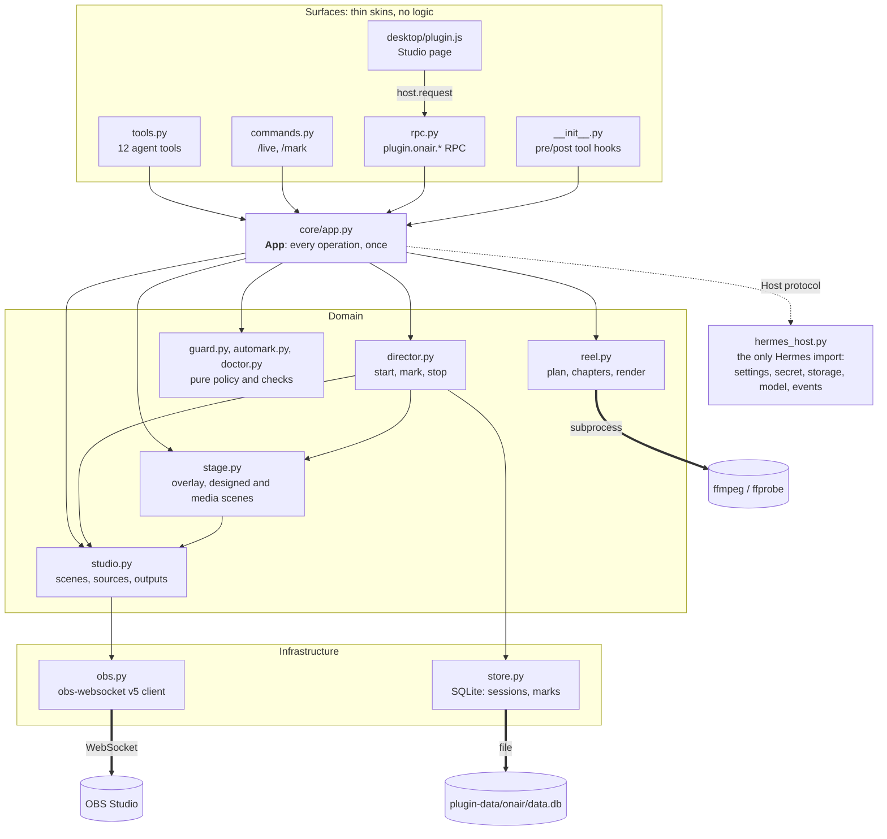
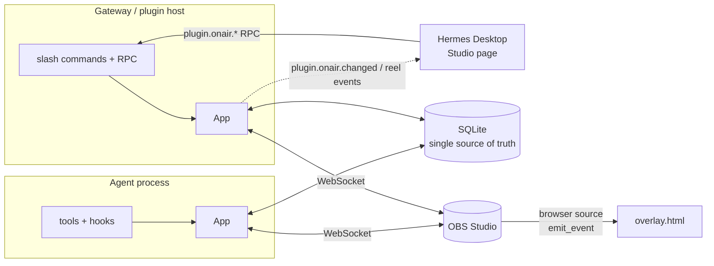
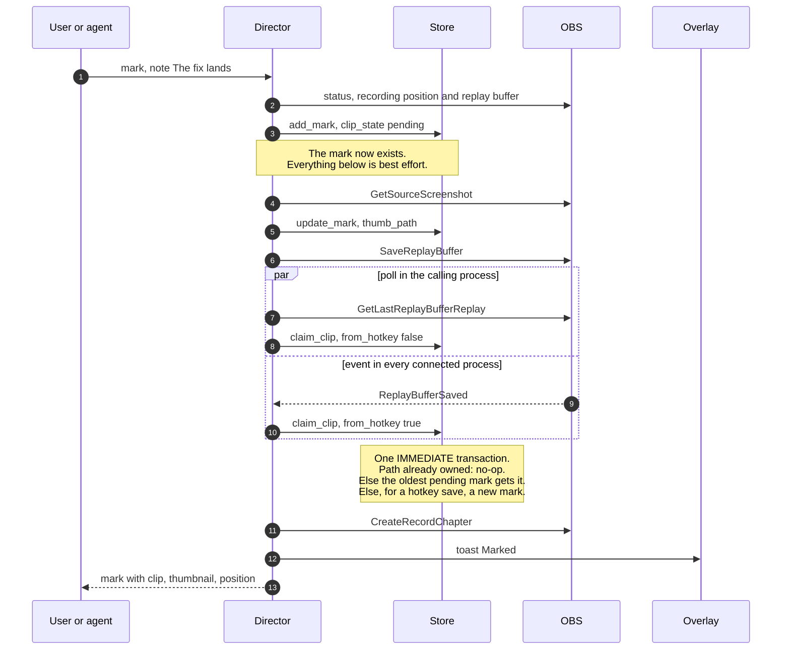
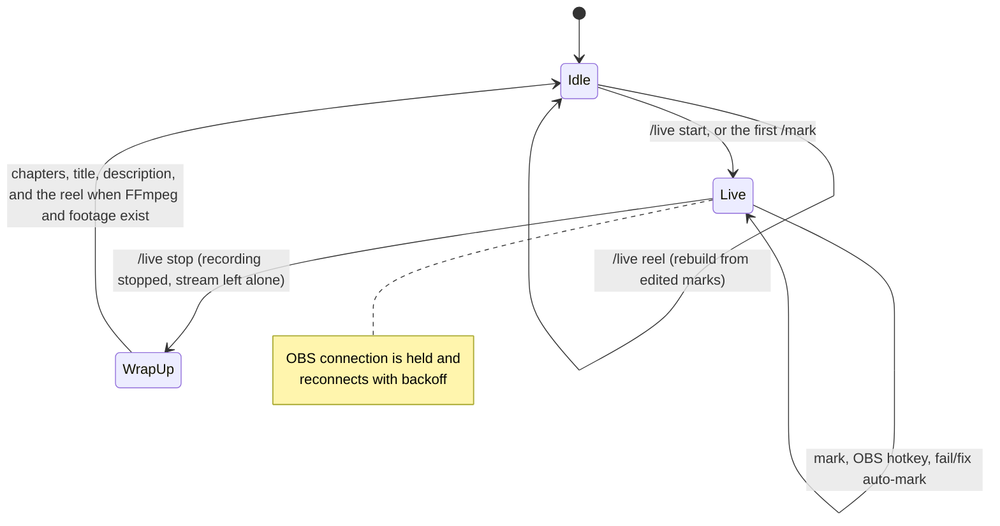
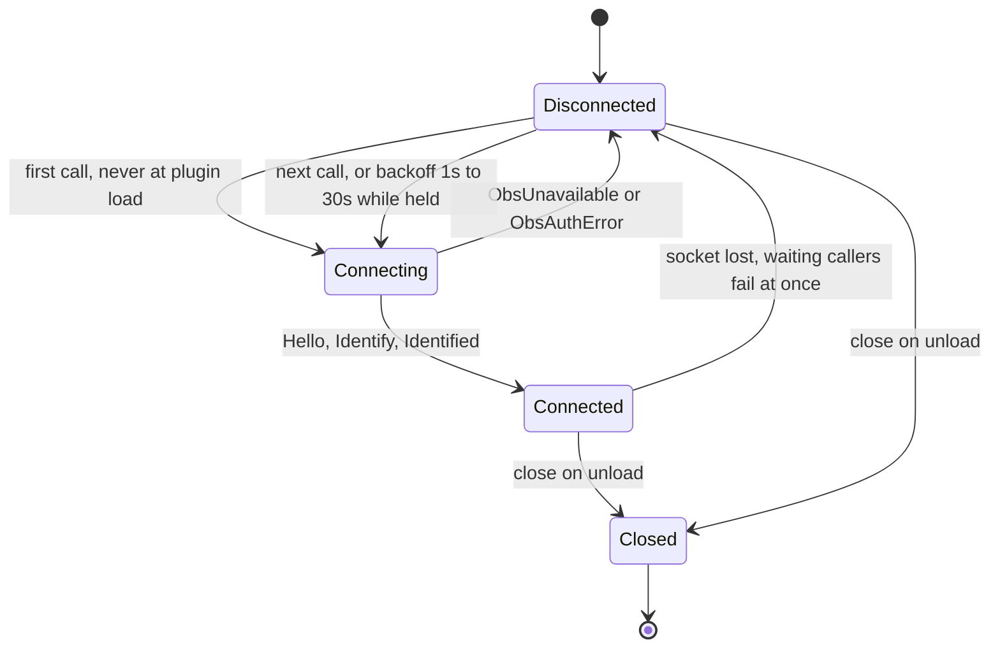

# Architecture

Three skins over one application, over a Hermes-free core.

## Layers

Dependencies point downwards only. Nothing in `core/` imports Hermes.

## Processes

Hermes runs plugin code in more than one process. Each has its own lazy OBS connection; the
database is what they share.

## A mark, end to end

The mark is durable before OBS is asked for anything. The replay file is paired with its mark
by `claim_clip`, whichever process hears about the file first.

## Session lifecycle

## OBS connection

## Modules

| Module | Interface | What it hides |
|---|---|---|
| `core/obs.py` | `call`, `call_batch`, `subscribe`, `hold`, `close` | Lazy connect, auth, request/response correlation, reader and dispatcher threads, one retry when a request never left, reconnect with backoff |
| `core/studio.py` | scenes, sources, outputs, `screenshot`, `status` | obs-websocket request names, per-platform input kinds, bounds-based transforms, idempotency (add twice = update) |
| `core/stage.py` | overlay verbs, `design_scene`, `play` | HTML assets, publishing them and imported media to the data directory, which OBS source plays which file type, the obs-browser event channel |
| `core/store.py` | sessions, marks, `claim_clip` | Schema, transactions, pairing a saved replay with its mark exactly once across processes |
| `core/director.py` | `start`, `mark`, `stop` | Mark-first ordering, best-effort decoration, OBS event handling |
| `core/automark.py` | `observe` | Fail-then-fix pairing, bounded memory |
| `core/reel.py` | `plan_reel`, `youtube_chapters`, `draft_wrapup`, `ReelBuilder.build` | FFmpeg argument lists, normalising clips, chapter cards |
| `core/guard.py` | `review`, `safety` | The approval policy: audience prompts (can be switched off) and safety prompts (always asked) |
| `core/weburl.py` | `public_web_url` | Refuses links that are not public http(s) addresses before OBS's browser gets them |
| `core/app.py` | one method per user-visible operation | Composition, capture privacy, wrap-up, background work |

## Seams

Each has two real adapters, production and test:

- **Transport** (`obs.Connector`): `websockets` in production, `tests/fake_obs.FakeObs` in tests.
  The fake keeps real OBS state, so tests assert on outcomes, not on which requests were sent.
- **Host** (`app.Host`): `hermes_host.HermesHost` in production, `FakeHost` in tests.
- **FFmpeg runner** (`reel.Runner`): `subprocess` in production (and in `test_reel_render.py`),
  a recorder in the application tests.

## Decisions

- **SQLite is the only source of truth.** Tools run in the agent process, slash commands and the
  Desktop RPC in the gateway or plugin host. Each process has its own OBS connection; all share
  the database. `claim_clip` runs in one `BEGIN IMMEDIATE` transaction so a replay file reported
  by several processes still produces one mark.
- **A mark is written before anything else is attempted.** Clip, thumbnail, recording chapter
  and toast are decorations; any of them may fail.
- **Tools are nouns with an `action`**, not one tool per OBS request. Twelve tools, plus
  `live_obs_request` as the escape hatch, keeps the model's choice small without capping what it
  can do.
- **The overlay has no server and no polling.** Updates arrive as obs-browser `emit_event`
  custom events. Every element hides itself on a timer, so a lost update cannot strand anything
  on screen.
- **Assets are copied to the plugin data directory**, because `hermes plugins update` replaces
  the install directory and OBS remembers file paths.
- **Media from other tools comes in as a file path, nothing more.** The plugin does not call
  Hermes's image, video or speech tools; the agent does, and hands over the file. That keeps the
  plugin working with any tool that writes a file, including ones that do not exist yet. Files
  are copied in, because generators write to caches that get cleaned.
- **One-shot sounds and clips need no timer.** They are non-looping media sources that clear
  themselves when the file ends, so nothing has to come back later to remove them.
- **Chapter cards are drawn with Pillow**, not FFmpeg's `drawtext`, which many FFmpeg builds
  (Homebrew's included) are compiled without.
- **The Desktop half talks to the plugin over `ctx.register_rpc`**, not a separate
  `dashboard/plugin_api.py`. That file is imported outside the plugin package, which would mean
  a second copy of the application and its OBS connection.
